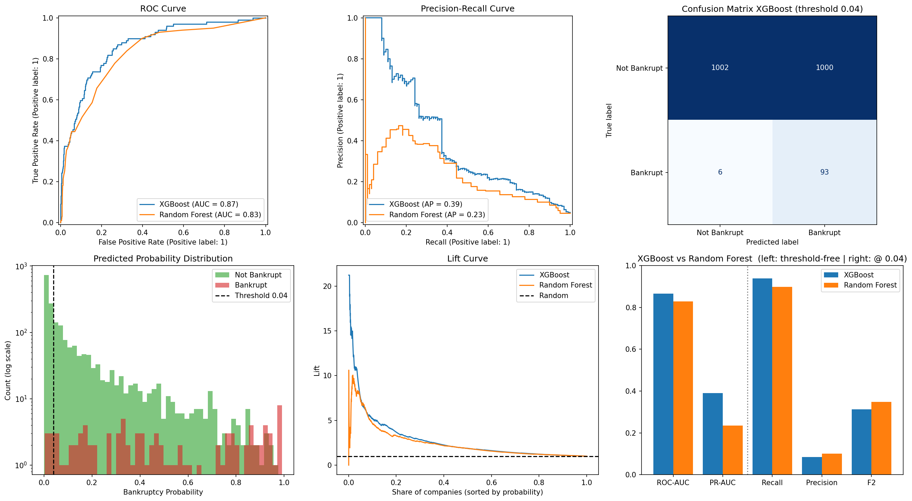
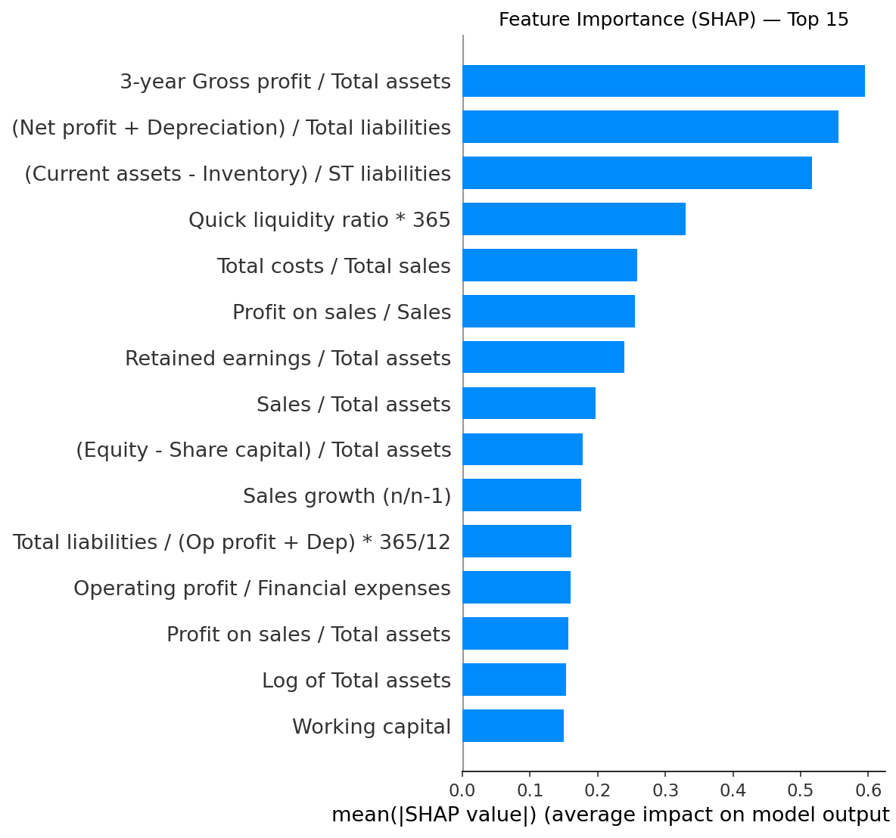

# Corporate Bankruptcy Prediction — Credit-Risk Screening with XGBoost

An end-to-end ML pipeline that flags companies at risk of bankruptcy from their financial ratios. It is designed as a **first-stage screening filter** for a bank's credit team: the model catches ~94% of future bankruptcies while auto-clearing almost half of all applicants, so analysts spend their time where the risk actually is.



## Key results

Test set: 2,101 companies (99 bankrupt), 3-year horizon dataset. Decision threshold 0.04, chosen on out-of-fold training predictions (see [Approach](#approach)); the test set was used once, for this final evaluation.

| Metric | XGBoost | Random Forest (baseline) |
|---|---|---|
| ROC-AUC | **0.865** | 0.828 |
| PR-AUC (Average Precision) | **0.390** | 0.235 |
| Recall @ 0.04 | **93.9%** (93 / 99) | 89.9% (89 / 99) |
| Precision @ 0.04 | 8.5% | 10.1% |

**What this means in practice:** of 2,101 companies, 1,008 (48%) are cleared automatically and only 6 of 99 future bankruptcies slip through. The remaining 1,093 go to manual review.

**Why XGBoost:** it is the stronger discriminator on both threshold-free metrics, and its PR-AUC is ~1.7× the baseline's — the metric that matters most with a ~5% positive rate. Point metrics at a single shared threshold are not a fair model comparison, because the two models' probabilities are calibrated differently.

## Approach

1. **Data** — [Polish Companies Bankruptcy dataset](https://archive.ics.uci.edu/dataset/365/polish+companies+bankruptcy+data) (UCI): 64 financial ratios for companies observed 2000–2013, five forecasting horizons (1–5 years ahead), ~5% bankrupt.
2. **Train/test split first** — stratified 80/20 split *before* any preprocessing, so nothing is fitted on test data.
3. **Outliers** — winsorization at the 1st/99th percentiles, with bounds learned on the training set only.
4. **Missing values** — MICE (`IterativeImputer`) with a Random Forest estimator, fitted on the training set and applied to the test set.
5. **Class imbalance** — `scale_pos_weight` tuned as a hyperparameter instead of resampling.
6. **Tuning** — Optuna, 50 trials per horizon, 5-fold stratified CV, **F2 objective** (a missed bankruptcy costs the bank more than an extra manual review).
7. **Threshold** — chosen on 5-fold out-of-fold predictions on the training set as the highest threshold that keeps **recall ≥ 90%** (the screening requirement). Out-of-fold recall at the chosen threshold: 92.2%; test recall: 93.9%.
8. **Interpretability** — SHAP.

### Data leakage fix

An earlier version fitted the winsorization bounds and the MICE imputer on the full dataset before splitting, and picked the decision threshold by looking at the test set. Both were fixed: preprocessing is now fitted on train only, and the threshold is selected out-of-fold. With the same tuning setup, test ROC-AUC moved from 0.862 (leaky) to 0.852 (clean) — a small leak, but the evaluation is now correct. Re-running Optuna moves ROC-AUC by about ±0.01; the reported numbers come from the final saved hyperparameters in `best_params.json`.

## What drives the predictions



The top drivers are long-run profitability (3-year gross profit / total assets), debt coverage ((net profit + depreciation) / total liabilities) and liquidity ((current assets − inventory) / short-term liabilities) — the same factors a credit analyst would check first, which is a good sanity check that the model learned economics rather than noise.

## Performance across horizons

Threshold-free metrics on each horizon's test set:

| Dataset | Predicts bankruptcy… | ROC-AUC | PR-AUC |
|---|---|---|---|
| 1year | 5 years ahead | 0.862 | 0.275 |
| 2year | 4 years ahead | 0.830 | 0.300 |
| 3year | 3 years ahead | 0.865 | 0.390 |
| 4year | 2 years ahead | 0.830 | 0.359 |
| 5year | 1 year ahead | 0.901 | 0.486 |

The closer to bankruptcy, the easier it is to detect. The final model uses the 3-year horizon: early enough to be useful for credit decisions, while still predictive. (PR-AUC's baseline equals the bankruptcy rate, which ranges from ~4% to ~7% across horizons, so it is only roughly comparable between rows.)

## Repository structure

```
├── bankruptcy_prediction.ipynb   # full pipeline: split → preprocessing → tuning → threshold → evaluation → SHAP
├── best_params.json              # tuned XGBoost hyperparameters per horizon
├── requirements.txt
├── data/                         # put the UCI .arff files here (not tracked)
├── images/                       # figures used in this README
└── docs/
    └── documentation.pdf         # full methodology write-up
```

## How to run

```bash
git clone https://github.com/lzanam1/bankruptcy-prediction.git
cd bankruptcy-prediction
pip install -r requirements.txt
```

1. Download the dataset from [UCI](https://archive.ics.uci.edu/dataset/365/polish+companies+bankruptcy+data) and put `1year.arff` … `5year.arff` into `data/`.
2. Open `bankruptcy_prediction.ipynb` and run the cells in order. To reproduce the reported numbers exactly, **skip section 3 (Optuna)** and run section 4, which loads `best_params.json`. Re-running Optuna (seeded, ~15 minutes on a GPU) gives slightly different hyperparameters.

Set `DEVICE = "cpu"` in the setup cell if you don't have a CUDA GPU.

## Limitations

- **Low precision by design.** At the screening threshold only ~1 in 12 flagged companies actually goes bankrupt. Fine for a first-stage filter, not for automatic loan rejection.
- **Random train/test split.** A time-based split would be a more realistic test of performance on future years.
- **Old data.** 2000–2013 Polish companies; ratios and default patterns may differ in today's economy.
- **Preprocessing inside CV.** The imputer is fitted on the full training set, so Optuna's CV folds share it. This affects only hyperparameter and threshold selection, not the final test evaluation; wrapping preprocessing in an sklearn `Pipeline` would remove it.

## Author

Daniil — Quantitative Methods in Economics & Information Systems, SGH Warsaw School of Economics.
